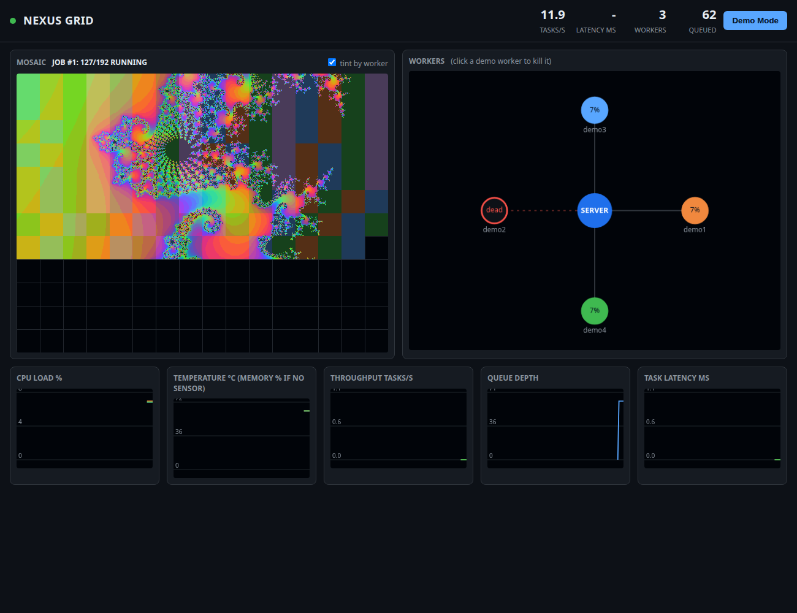
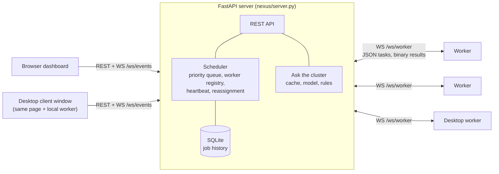

# Nexus Grid

A distributed computing prototype. A FastAPI server splits jobs into tasks, hands them to connected workers over WebSocket, collects the results, and re-assigns the tasks of a worker that dies. A live web dashboard shows the cluster; the same page runs in a native window as the desktop worker client. Task types: Mandelbrot tiles (visual demo) and image batch processing (resize, re-compress, convert).



- **Live demo (no key, no login):** https://nexus-grid-2ivy.onrender.com. Press **Demo Mode**, then click a demo worker in the graph to kill it and watch its tiles get re-assigned. Swagger UI is at `/docs`. The free host sleeps after 15 minutes idle; the first request can take about a minute.
- **Desktop client (Windows, macOS, Linux):** see [Desktop client](#desktop-client).
- Prompt the project started from: [PROMPT.md](PROMPT.md). Actual token spend: [TOKEN_LOG.md](TOKEN_LOG.md). Development log with failures and fixes: [DEVLOG.md](DEVLOG.md).

## Architecture



Components and failure handling are described in [docs/ARCHITECTURE.md](docs/ARCHITECTURE.md). In short: one task per worker at a time; a worker that disconnects or misses heartbeats for 5 s is declared dead and its task goes back to the front of the queue (up to 5 attempts); results from a worker that no longer owns the task are ignored; workers reconnect by themselves with backoff, which also covers a free host going to sleep.

## Packet format
JSON text frames for control (`hello`, `heartbeat`, `task`, `error`) and one binary frame for results:

| offset | size | field |
|---|---|---|
| 0 | u8 | frame type (1 = Mandelbrot tile, 2 = file result) |
| 1 | u32 | task id (big endian) |
| 5 | u16 | width in px |
| 7 | u16 | height in px |
| 9 | n | type 1: zlib(uint16 little-endian iteration counts); type 2: the encoded image file |

## API
REST + WebSocket, OpenAPI at `/docs`. Main calls: `POST /api/jobs`, `GET /api/jobs[/{id}]`, `DELETE /api/jobs/{id}`, `GET /api/workers`, `GET /api/metrics[/history]`, `GET /api/health`, `POST /api/ask`, `WS /ws/events`, `WS /ws/worker`. Full reference: [docs/API.md](docs/API.md). The public server needs no key; if a server is started with `NEXUS_API_KEY`, job writes and the worker socket require `X-API-Key` (optional feature).

```bash
curl -X POST https://nexus-grid-2ivy.onrender.com/api/jobs -H 'Content-Type: application/json' \
  -d '{"type":"mandelbrot","params":{"width":640,"height":480,"tile":40}}'
```

## Run

**Server** (Python 3.12+):
```bash
python3 -m venv .venv && .venv/bin/pip install -r requirements-dev.txt
.venv/bin/uvicorn nexus.server:app --port 8000        # honours $PORT; Docker: docker build -t nexus-grid . && docker run -p 8000:8000 -e PORT=8000 nexus-grid
```
**Dashboard:** open `http://localhost:8000/`.
**Worker** (start several): `.venv/bin/python -m nexus.worker --url http://localhost:8000 --name w1`
**Image batch:** `python tools/submit_images.py ./photos --max-side 800 --format WEBP --out out`, or choose *Image Batch* in the dashboard and press *+ New*.

## Demo steps
1. `NEXUS_URL=https://nexus-grid-2ivy.onrender.com demo/demo.sh` (or without `NEXUS_URL` against a local server): 4 workers connect, a 192-tile job renders, one worker is killed, its tiles are re-assigned, the job completes, a worker table is printed.
2. Or in the dashboard: **Demo Mode**, then click a demo worker to kill it. Recording script: [docs/DEMO.md](docs/DEMO.md).

## Desktop client
The desktop client is the dashboard page in a native window ([pywebview](https://pywebview.flowrl.com/)) with the Python worker running beside it. **My Worker** shows the local worker (load gauge, current task with live tile preview, stats, connection settings, log); **Observer** shows the whole cluster. The page is bundled in the executable, so it opens even while the free host sleeps.

Downloads ([v0.2.0 release](https://github.com/LoPHarp/nexus-grid/releases/tag/v0.2.0), built by GitHub Actions):
[Windows](https://github.com/LoPHarp/nexus-grid/releases/download/v0.2.0/nexus-worker-Windows.exe) ·
[macOS, Apple silicon](https://github.com/LoPHarp/nexus-grid/releases/download/v0.2.0/nexus-worker-macOS) ·
[Linux x86-64](https://github.com/LoPHarp/nexus-grid/releases/download/v0.2.0/nexus-worker-Linux)

**Build status: the Linux binary was built by CI and I ran it by hand. The Windows and macOS binaries were produced by CI (GitHub Actions) and have not been run manually.** None are code-signed.

Run: start it, open **My Worker**, check the server URL (`https://nexus-grid-2ivy.onrender.com`), press **Connect**. No key is needed on the public server.
- Windows: double-click; SmartScreen says "unknown publisher": More info, Run anyway.
- macOS: `chmod +x nexus-worker-macOS && xattr -d com.apple.quarantine nexus-worker-macOS && ./nexus-worker-macOS`.
- Linux: `chmod +x nexus-worker-Linux && ./nexus-worker-Linux` (needs a desktop session).

From source: `pip install -r requirements-client.txt && python -m nexus.desktop`. Rebuild: `tools/build_client.sh` (current OS only); CI: `.github/workflows/build-client.yml` runs on `v*` tags and manually.

## UI
Implements [docs/design/DESIGN.md](docs/design/DESIGN.md) in `web/` (plain HTML, CSS and JS, no framework; Inter and JetBrains Mono bundled, OFL): HUD with odometer counters and sparklines, tile mosaic, worker graph with pulses, failure sequence with reassignment chips, per-worker charts, event feed, My Worker view, empty / reconnecting / server-sleeping / error states, compact layout, reduced-motion path. Screenshots from this build: [observer](docs/ui-check/observer.png), [failover](docs/ui-check/failover.png), [my-worker](docs/ui-check/my-worker.png) (rendered with a stub of the desktop API), [compact](docs/ui-check/compact.png), [ask](docs/ui-check/ask.png).

## AI features and roadmap
**Implemented: Ask the cluster** (sparkle button in the top bar, or `POST /api/ask`). Answer order: response cache (60 s, keyed by question and coarse cluster state) -> a free model through FreeLLMAPI, a local router to free models (OpenAI-compatible; enabled with `FREELLMAPI_URL`, `FREELLMAPI_KEY`, optional `FREELLMAPI_MODEL`) -> answers recorded from a free model in `data/ai_seed.json` -> rule-based answer from the same facts. The `source` field and the UI label say which one answered, so a slow or rate-limited model never breaks the demo. Model calls are limited to 6 per minute, the endpoint to 30. Only counts, worker names, sensor values and event names go to the model, never keys or file contents.

Roadmap (not built):
1. Smart scheduler: predict task duration per worker from past latencies and assign by expected finish time.
2. Anomaly detection on worker metrics (overheating, rising latency before a crash) with an alert in the event feed.
3. Richer questions: pass metric history to the model instead of a snapshot, and let it reference tiles and jobs.

## How tokens were minimized (and what did not work)
Rules in [CLAUDE.md](CLAUDE.md): short answers, one stage at a time with a stop for review, read only needed files, never print a file back after writing it, commit after each logical step. Token counts come from Claude Code's own logs via `tools/log_tokens.sh` (input, output, cache write, cache read per snapshot, per-stage table in [TOKEN_LOG.md](TOKEN_LOG.md)).

What this honestly shows:
- **Cache reads dominate the total** (over 95 % of the counted tokens): a long session re-reads its context on every turn. Uncached input and output are the small numbers; the total column overstates cost.
- **The most expensive parts** were the UI rebuild and the bug-fix round (many screenshots, headless-browser debugging), not the server core.
- **Delegation to free models saved almost nothing.** Per the rules only simple work may be delegated; in practice that was 7 calls (about 3 000 tokens) to record sample answers for the AI feature, and roughly half of them came back truncated or useless and were redone or dropped. Writing the prompts and reviewing the output cost about as much as doing it directly. Design, protocol, failover, UI and debugging were deliberately not delegated.
- Not in the logs: the planning chats in the Claude chat app before the first commit (idea, plan, free-model router setup).

## Evidence
| Claim | Command |
|---|---|
| Queue, priorities, heartbeat timeout, reassignment, stale results, retry limit | `.venv/bin/python -m pytest tests/test_core.py` |
| Real processes: a worker is killed mid-job and the job still completes | `.venv/bin/python -m pytest tests/test_failover.py` or `demo/failover.sh` |
| Same scenario against the public server (4 workers, kill 1, 192/192 done) | `NEXUS_URL=https://nexus-grid-2ivy.onrender.com demo/demo.sh` |
| Workers reconnect after a server restart | `tests/test_failover.py::test_worker_reconnects_after_server_restart` |
| Only Demo Mode workers can be killed through the API or the UI | `tests/test_failover.py::test_only_demo_workers_are_killable_and_flagged`, `tests/test_ui_headless.py` |
| Optional `X-API-Key` is enforced only when the server sets one; metrics history | `tests/test_auth_history.py` |
| Mosaic, graph and charts keep redrawing after Observer / My Worker / Demo Mode (real mouse, headless Chrome, normal and reduced motion) | `.venv/bin/python -m pytest tests/test_ui_headless.py` |
| Native window: view switch, connect/disconnect, kill by click, native save of PNG and zip | `.venv/bin/python -m pytest tests/test_desktop_window.py` (needs a display) |
| Image batch: resize, convert, zip download, bytes not stored in the job record | `tests/test_image.py` |
| Ask the cluster: cache, model failure fallback, rate limit, recorded answers | `tests/test_ai.py` |
| Actual token spend | `TOKEN_LOG.md`, produced by `tools/log_tokens.sh` |
| The whole suite | `.venv/bin/python -m pytest` |

## Known limitations
- SQLite is ephemeral on Render's free plan (no persistent disk): job history is lost on restart or redeploy. Tile and image results and the metrics history are in memory only; running jobs are marked `aborted` after a restart.
- A free Render service sleeps after 15 minutes and needs about a minute to wake; workers retry with backoff. Free-tier WebSocket connections may be dropped by the platform; workers reconnect.
- The public demo server is open: anyone can submit jobs, connect workers and start Demo Mode. The optional shared key (`NEXUS_API_KEY`) is the only access control; there are no accounts.
- Demo Mode workers are subprocesses of the server and compete with it for CPU on the small free instance.
- One task per worker at a time. Not load-tested beyond a handful of local workers.
- Image batch sends files inside JSON (base64): at most 50 images, 5 MB each, 25 MB per job.
- Ask the cluster: the live model path (HTTP to FreeLLMAPI) is covered by unit tests with a fake model only; I had no FreeLLMAPI HTTP key here. The public server has no model and answers from recorded answers or rules.
- UI vs the concept art: the mosaic shows the real 192 tiles (16x12), not the 36 large tiles of the mockup; event times are 24 h; priority is shown, not editable. A visual freeze of the mosaic and graph reported in manual testing could not be reproduced here; the defects found in that code path were fixed and a repair loop was added (see DEVLOG), but whether they were the cause is not proven. Hover motion and 60 fps were not measured.
- The Linux client bundles Qt WebEngine (about 250 MB); Windows and macOS use the system web view. The 60 s cold start of Render was not timed against the "server waking up" screen.

## Roadmap
Ideas listed under AI features; plus persistent storage (an external free database), per-user access control, and worker task pipelining.
